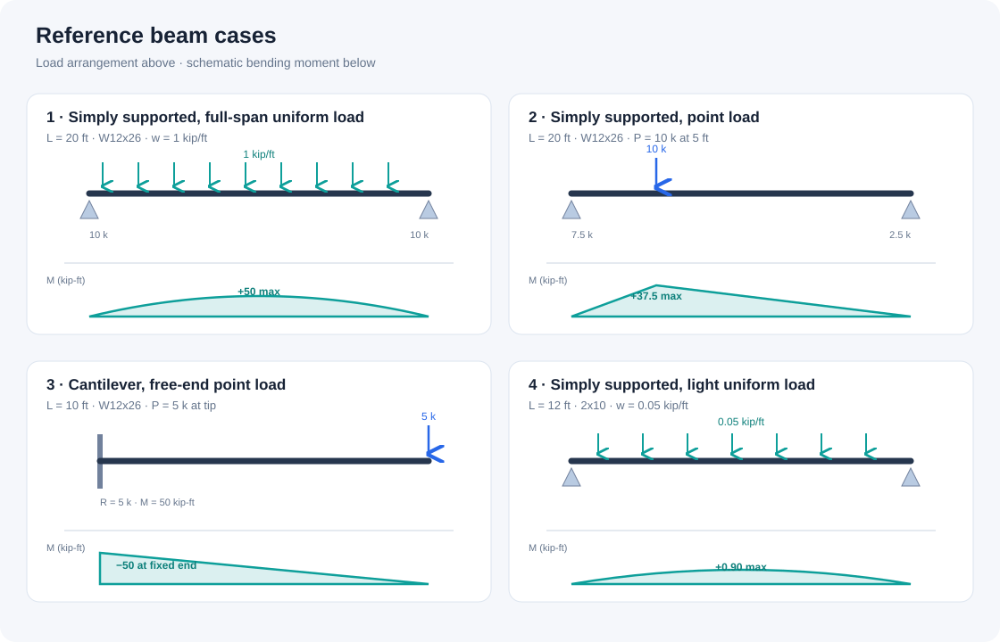

# Beam Designer

Beam Designer is a small desktop tool for exploring single-span beam behavior. Set a span and support condition, add point and uniform loads, choose a steel or lumber section, and inspect the shear, moment, and deflection response alongside basic bending and deflection checks. The plots update as the inputs change.

> **Scope:** This is an educational and preliminary sizing aid. It checks flexural stress and elastic deflection for simply supported beams and left-fixed cantilevers. It does not check self-weight, shear stress, lateral-torsional buckling, load combinations, or continuous beams. Confirm assumptions and design requirements independently before using results for construction.

## Example beam cases

The diagrams below sketch the four calculation examples used for validation. The moment shapes are schematic; values and support reactions are listed below and are calculated by the app.



| Case | Beam and loading | Reference results |
|---|---|---|
| 1 | 20 ft simply supported, W12x26, 1 kip/ft across the span | Reactions 10 k each; max shear 10 k; max moment 50 kip-ft at midspan; bending stress 17.96 ksi; max deflection 0.609 in; L/360 = 0.667 in |
| 2 | 20 ft simply supported, W12x26, 10 kip point load at 5 ft | Reactions 7.5 k and 2.5 k; max moment 37.5 kip-ft at 5 ft; bending stress 13.47 ksi; max deflection about 0.340 in near 8.82 ft |
| 3 | 10 ft cantilever, W12x26, 5 kip at the free end | Fixed reaction 5 k and fixed-end moment 50 kip-ft; max deflection about 0.487 in at the free end; L/360 = 0.333 in |
| 4 | 12 ft simply supported, 2x10, 0.05 kip/ft across the span | Max moment 0.90 kip-ft; bending stress 0.505 ksi; max deflection 0.147 in |

## Requirements and launch

- Python 3.10 or newer
- NumPy and Matplotlib (Tkinter is included with most standard Python installations; on some Linux distributions it is a separate system package)

Install the Python packages and launch from the project directory:

```powershell
python -m pip install -r requirements.txt
python app.py
```

The app starts with Case 1 loaded. The left panel controls support type, span, loads, material, section, and the L/240 or L/360 deflection limit. Add and remove loads with the buttons and × controls. Edit the numeric fields to update the analysis; point loads can also be dragged along the beam and snap to quarter-foot positions. Use the dark-mode toggle to change the plot theme.

The plots show the beam and loads, followed by shear, moment, and deflection diagrams. Hover over a diagram to inspect values at a span location. The check cards compare bending stress with the material allowable and maximum deflection with the selected span limit. The recommendation offers the lightest passing steel section (weight ties favor larger Ix), or the first passing lumber entry in the table. **Use section** selects that recommendation.

## Equations and conventions

The model uses downward load magnitudes as positive input values. Lengths are entered in feet, forces in kips, and distributed loads in kips per foot. Moment is reported in kip-ft; deflection is reported in inches. Reactions and internal actions use static equilibrium. The app ignores self-weight.

### Resultant loads and reactions

For a point load `P` at `a`, the resultant is `P` at `a`. For a uniform load `w` between `a` and `b`:

```text
Q = w (b - a)                 resultant force (kips)
xQ = (a + b) / 2             resultant location (ft)
```

Summing all loads gives `W = ΣQ` and their first moment about the left end gives `J = Σ(Q xQ)`. For a simply supported span `L`:

```text
Rright = J / L
Rleft  = W - Rright
```

For a cantilever fixed at the left end:

```text
Rleft = W
Mfixed = J
```

### Shear and bending moment

For a simply supported beam, at a section `x`, loads to the left contribute to the internal force and moment:

```text
V(x) = Rleft - Σ Pᵢ H(x - aᵢ) - Σ wⱼ ℓⱼ(x)
M(x) = Rleft x - Σ Pᵢ max(0, x - aᵢ)
       - Σ [ wⱼ ℓⱼ(x) (x - (aⱼ + cⱼ(x))/2) ]
```

Here `H` is the step function, `cⱼ(x) = min(x, bⱼ)`, and `ℓⱼ(x) = max(0, cⱼ(x) - aⱼ)` is the loaded length of uniform-load segment `j` to the left of the section. Each load segment is clipped to the beam span.

For a cantilever, use the loads to the right of the section:

```text
V(x) = -Σ Pᵢ [aᵢ ≥ x] - Σ wⱼ max(0, bⱼ - max(x, aⱼ))
M(x) = -Σ Pᵢ max(0, aᵢ - x)
       - Σ [ wⱼ ℓⱼʳ(x) ((max(x, aⱼ) + bⱼ)/2 - x) ]
```

where `ℓⱼʳ(x) = max(0, bⱼ - max(x, aⱼ))`. The force and moment signs follow the implementation's downward-positive load convention; checks use the absolute maximum moment.

### Elastic deflection and checks

The software integrates the elastic beam equation numerically over a span grid that includes load locations and uniform-load boundaries:

```text
κ(x) = M(x) / (E I)          curvature
dy/dx = θ(x)
dθ/dx = κ(x)
```

The trapezoidal rule integrates curvature to slope and slope to displacement. For a simply supported beam, a linear correction enforces `y(0) = y(L) = 0`. For a cantilever, the fixed-end slope and displacement start at zero. The reported maximum deflection is the largest absolute sampled displacement.

```text
fb = 12 |Mmax| / Sx          bending stress (ksi), Mmax in kip-ft
δallow = 12 L / n            deflection limit (in), L in ft, n = 240 or 360
PASS bending   if fb ≤ Fb
PASS deflection if |y|max ≤ δallow
```

`E` is in ksi, `I` is in in⁴, and `Sx` is in in³. The factor 12 converts kip-ft to kip-in in the bending stress expression. The listed material properties and sections are in [spec.md](spec.md). The app uses the selected section's `E` and `I` for its displayed deflection; when evaluating a recommendation, it scales deflection in inverse proportion to each candidate section's `I`.

## Validation tests

Run the analysis tests from the repository root:

```powershell
python -m unittest discover -s tests -v
```

The tests cover the four examples above and load clipping/zero-length uniform-load behavior. They test the calculation module without opening the desktop window.
